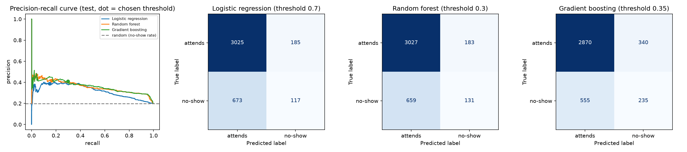
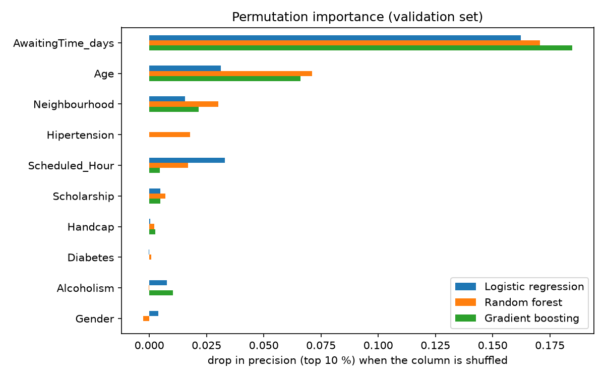

# Medical Appointment No-Show Prediction

Can we predict, **at the moment an appointment is booked**, whether the patient will miss it? This project answers that question with a supervised learning pipeline on 110,527 real medical appointments from the public health network of Vitória (Brazil). It compares a logistic regression, a random forest and gradient boosting under a metric chosen for how a clinic would actually use the prediction.

Assignment A1 (*The Supervised Learning Challenge*) of the course **Neural and Evolutionary Computation**, Master's Degree in Computer Security Engineering and Artificial Intelligence, Universitat Rovira i Virgili (URV), October 2026. The full report is in [`report/`](report).

## Key results

Among the 10% of appointments with the highest predicted risk, the tree ensembles find about **42% no-shows, more than twice the 19.8% no-show rate**:

| Model | Precision top 10% (test) | Average precision (test) |
|---|---|---|
| Dummy (baseline) | 0.170 | 0.198 |
| Logistic regression (C = 0.1) | 0.395 | 0.321 |
| Random forest (300 trees, min. 100 per leaf) | **0.422** | 0.358 |
| Gradient boosting (η = 0.03, 100 rounds, depth 3) | **0.422** | **0.363** |

- **Waiting time** between booking and appointment drives the prediction, followed by **age**. Same-day appointments are almost never missed, while any wait raises the risk to a similar level. Trees capture this jump directly; the linear model cannot.
- The precision is not high enough to double-book slots, since more than half of the flagged patients would still come. It is better suited to a cheaper action, such as a confirmation call.





## Methodology

**1. Exploration.** Types, placeholders, duplicates, impossible values (negative ages and waits), distributions, correlations and the target balance.

**2. Data preparation**
- Removal of 618 duplicate appointments and 6 rows with impossible values.
- New features: `AwaitingTime_days` (days between booking and appointment) and `Scheduled_Hour`.
- **Leakage control:** only information known at booking time is used. `SMS_received` is dropped: the reminder is sent after booking (never for waits of 1 day or less), so it would leak future information.
- **One appointment per patient** (62,298 patients), because appointments of the same patient are not independent, then a sample of 20,000.
- Stratified 60/20/20 split (12,000 / 4,000 / 4,000). Every learned transformation (scaling, one-hot encoding) is fitted on the training set only, inside a scikit-learn `Pipeline`.
- Measured decision on the `Neighbourhood` encoding: rare neighbourhoods (< 1%) grouped into one column, compared on validation against one column per neighbourhood.

**3. Modelling and evaluation**
- **Metric: precision.** A flagged appointment would have its slot given to another patient, so a false positive means two patients arriving at the same time. Because each model flags a different number of appointments at the same threshold, the models are compared on the **precision of the 10% most risky appointments**, plus the average precision (area under the precision-recall curve).
- Hyperparameters tuned on validation with train/validation curves: regularisation (L1 vs L2) for the logistic regression, leaf size and features per split for the random forest, learning rate, rounds and depth for gradient boosting.
- Test set used **once**, at the end. A decision threshold per model is chosen on validation.
- Interpretation: permutation importance, a random-noise column to compare impurity-based and permutation importance, feature removal, an experiment adding each patient's attendance history, and an error analysis of the best model.

## Repository structure

```
.
├── no_show_prediction.ipynb   Full analysis: exploration, preparation, models, evaluation
├── figures/                   Figures generated by the notebook
├── report/                    Written report (PDF)
├── data/                      Place the Kaggle CSV here (not included)
└── requirements.txt
```

## How to run

1. Download the dataset from [Kaggle](https://www.kaggle.com/datasets/joniarroba/noshowappointments) and place `KaggleV2-May-2016.csv` in [`data/`](data).
2. Install the dependencies (Python 3.13) and open the notebook:

```bash
python -m venv .venv && source .venv/bin/activate   # Windows: .venv\Scripts\activate
pip install -r requirements.txt jupyter
jupyter notebook no_show_prediction.ipynb
```

All random steps use a fixed seed. The notebook and its comments are in Spanish; the report is in English.

## Data

*Medical Appointment No Shows*, published on Kaggle by Joni Hoppen under a CC BY-NC-SA 4.0 licence. Appointments booked between November 2015 and June 2016 in Vitória (Espírito Santo, Brazil). The results are limited by the data: a single city and six weeks of appointments from 2016.

## Author

**Francisco Sánchez Orozco**
